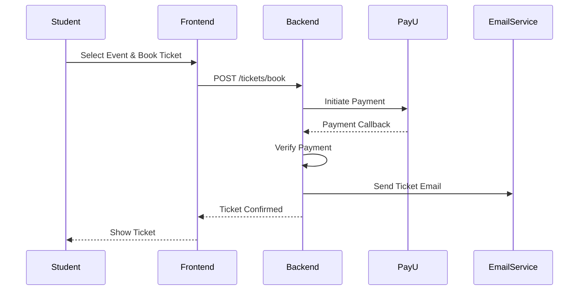
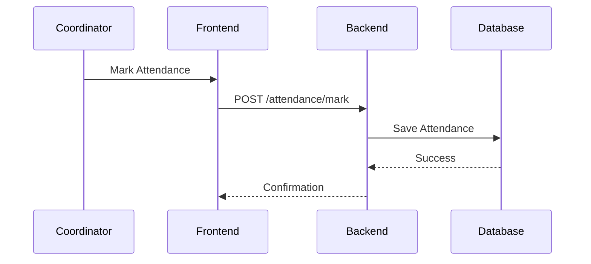
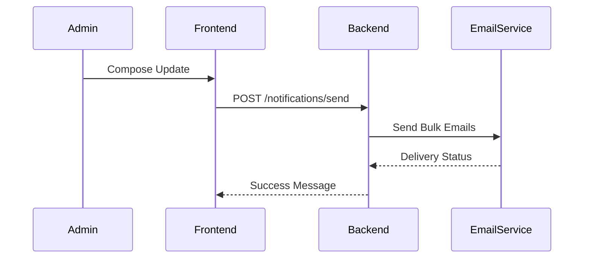
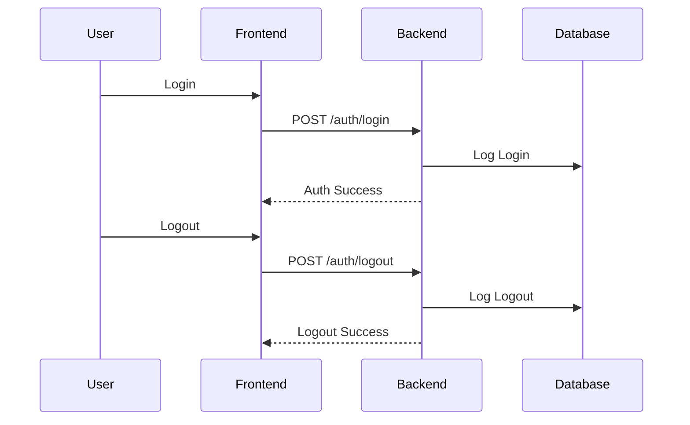

# SEQUENCE DIAGRAMS

---
## 🎟 Sequence Diagram: Ticket Booking & Payment

### **Flow**

1. Student selects event
2. Books ticket
3. Payment initiated via PayU
4. PayU callback received
5. Ticket confirmed
6. Email sent

### **Mermaid Diagram**

---

## 📊 Sequence Diagram: Attendance Marking

---

## 📧 Sequence Diagram: Send Event Updates

---

## 🔐 Sequence Diagram: Login & Logout Tracking

---

---
# 3. Use Case Diagrams (Role-Based)

## **Use Case Diagram – Super Admin**

### **Actors**

* Super Admin

### **Use Cases**

* Login / Logout
* View Dashboard
* Create & Manage Events
* Add New Student
* View Tickets & Ticket Details
* Upload ID Card Template
* Download Bulk Tickets
* Send Email Updates
* View & Export Attendance
* Track User Login/Logout

---

## **Use Case Diagram – Coordinator**

### **Actors**

* Coordinator

### **Use Cases**

* Login / Logout
* View Tickets
* View Ticket Details
* Download Bulk Tickets
* Mark Attendance
* Export Attendance Sheet

---

## **Use Case Diagram – Student**

### **Actors**

* Student

### **Use Cases**

* Register Account
* Login / Logout
* View Events
* Book Ticket
* Make Payment (PayU)
* View Dashboard
* Download Ticket
* Receive Email Notification

---

## **Use Case Diagram – Administration**

### **Actors**

* Administration

### **Use Cases**

* Login / Logout
* Manage Users
* Assign Roles
* Enable / Disable Accounts
* View Reports
* Reset Passwords

---
